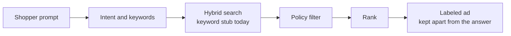
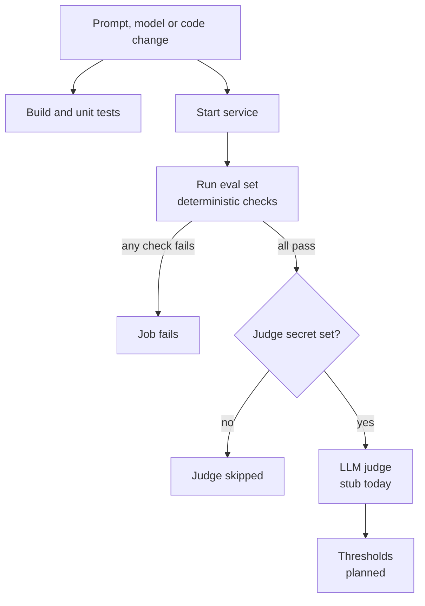

<p align="center"></p>

<h1 align="center">chat-ads-eval — Contextual Ads for Shopping Chat</h1>

<p align="center"><strong>Relevant, clearly labeled sponsored products for conversational shopping, guarded by a CI eval gate.</strong></p>

<p align="center">
  <a href="https://github.com/dakshshukla10/chat-ads-eval/actions/workflows/ci.yml"></a>
  <a href="https://github.com/dakshshukla10/chat-ads-eval/actions/workflows/eval-gate.yml"></a>
  <a href="LICENSE"></a>
  
</p>

<p align="center">
  
  
  
  
  
  
</p>

> 🚧 **Status: in active development**
> _Phase 1 complete — see the roadmap below._ Retrieval is a keyword stub over a synthetic catalog; nothing here has been run on real traffic.

---

## 💡 Why

Shopping assistants are becoming a place where people decide what to buy, and ads shown there have to meet three bars:

- **Relevant:** the sponsored product fits what the shopper just asked for.
- **Clearly labeled:** every ad says `Sponsored`, in a field of its own.
- **Separate from the answer:** ad text never leaks into the assistant's answer.

Prompts, models and ranking rules change often, and any of those changes can quietly break one of the three. This repo treats the checks as code: a regression gate runs on every change.

---

## ✨ Features

### ⚡ 1. Contextual ad service

- **Endpoint:** `POST /v1/ads/contextual` takes `{prompt}` and returns labeled sponsored items.
- **Separate slots:** `answer_slot` is always `null` here; the host assistant owns the answer.
- **Pipeline:** retrieve, policy filter, rank, label, in separate packages (`retrieval`, `policy`, `ranking`, `api`).

```json
{
  "answer_slot": null,
  "sponsored": [
    {
      "product_id": "p-1001",
      "title": "Trailblaze Running Shoes",
      "label": "Sponsored",
      "reason": "Matches your request: running, shoe"
    }
  ]
}
```

### 🛡️ 2. Eval gate

- **Deterministic checks:** a small Java library checks schema, label, ad/answer separation and banned categories.
- **Eval set:** 30 synthetic shopping prompts with expected categories, in `evals/prompts.jsonl`.
- **CI gate:** a runner exits non-zero when any check fails; an LLM judge is wired as a skipped stub.

### 📈 3. Observability

- **Prometheus endpoint:** `/actuator/prometheus` with request, served, fallback and policy-filtered counters.
- **Grafana:** provisioned dashboard with panels for p95 latency, token cost and fallback rate.

### Feature status

| Feature | Status | Notes |
| :-- | :-: | :-- |
| Spring Boot skeleton and `/v1/ads/contextual` | ✅ | Keyword-stub retrieval over an in-memory synthetic catalog |
| Policy filter (banned categories) | ✅ | One shared list, used by the filter and by the eval check |
| Deterministic eval checks (library + tests) | ✅ | JUnit 5 |
| Eval set and runner | ✅ | 30 synthetic prompts, exit code 1 on failure |
| CI and eval-gate workflows | ✅ | GitHub Actions |
| Prometheus metrics endpoint | ✅ | Counters and a latency histogram |
| Grafana dashboard | 🚧 | Panels exist; token cost stays at zero until a model is called |
| Docker Compose stack | 🚧 | Redis and Postgres+pgvector run but the service does not use them yet |
| Hybrid keyword + vector retrieval | 🚧 | Design chosen in [docs/architecture.md](docs/architecture.md); not built |
| Redis response cache | 📋 | Planned, Phase 2 |
| LLM-as-judge | 📋 | Stub only: reads a key from the environment, scores nothing |
| Eval thresholds in CI | 📋 | Planned, Phase 3 |
| Kubernetes deploy | 📋 | Planned, Phase 5 |

---

## ✅ Eval Checks

| Check | Type | Status | What it verifies |
| :-- | :-: | :-: | :-- |
| `schema_valid` | Deterministic | ✅ | Exact fields, non-blank strings, `answer_slot` null or text |
| `labeled_sponsored` | Deterministic | ✅ | Every ad has the label `Sponsored` |
| `ad_not_in_answer` | Deterministic | ✅ | Ad title, reason and id never appear inside `answer_slot` |
| `no_banned_category` | Deterministic | ✅ | No ad from a banned category |
| `expected_category` | Deterministic | ✅ | Top ad matches the prompt's expected category, or no ad when none is expected |
| Relevance | LLM judge | 📋 | Planned, Phase 3 |
| Ad-answer separation | LLM judge | 📋 | Planned, Phase 3 |
| Safety | LLM judge | 📋 | Planned, Phase 3 |

`ad_not_in_answer` is covered by unit tests with answer text. Over HTTP it passes trivially today because this service leaves `answer_slot` empty. `expected_category` runs against a synthetic catalog and set built for the stub retriever, so it checks the pipeline's wiring, not real-world relevance.

---

## 🏗️ Architecture

**Request flow**



**CI eval gate**



More detail, including the search-backend decision (Postgres full-text + pgvector), is in [docs/architecture.md](docs/architecture.md).

---

## 🧰 Tech Stack

| Layer | Choice | Status |
| :-- | :-- | :-: |
| Language / runtime | Java 21 | ✅ |
| Framework | Spring Boot 3.5 | ✅ |
| Build | Maven (wrapper included) | ✅ |
| Tests | JUnit 5, Spring MockMvc | ✅ |
| CI | GitHub Actions | ✅ |
| Metrics | Micrometer, Prometheus | ✅ |
| Dashboards | Grafana (provisioned) | 🚧 |
| Search backend | Postgres full-text + pgvector | 🚧 |
| Cache | Redis | 📋 |
| Deploy | Kubernetes | 📋 |

---

## 🚀 Quickstart

You need JDK 21 for the Maven wrapper and Docker for the optional stack.

```bash
cp .env.example .env            # only needed for docker compose
./mvnw verify                   # build + all tests (includes the full eval set in-process)
./mvnw spring-boot:run          # start the service on :8080
```

Ask for an ad:

```bash
curl -s -X POST localhost:8080/v1/ads/contextual \
  -H 'content-type: application/json' \
  -d '{"prompt":"noise cancelling headphones for my commute"}'
```

Run the eval gate against the running service:

```bash
./mvnw -q exec:java -Dexec.mainClass=dev.chatads.eval.EvalRunner
```

Start Redis, Postgres, Prometheus and Grafana (Grafana on http://localhost:3000, Prometheus on http://localhost:9090):

```bash
docker compose up -d
```

Configuration is by environment variable; see [.env.example](.env.example). The LLM judge key (`LLM_JUDGE_API_KEY`) is optional and is never committed.

---

## 🔭 Observability

- **Latency:** the built-in `http.server.requests` timer, with a percentile histogram so Prometheus can compute p95.
- **Counters:** `chatads_requests_total`, `chatads_sponsored_served_total`, `chatads_fallback_total`, `chatads_policy_filtered_total`.
- **Token cost:** `chatads_llm_tokens_total` is registered but stays at zero until a model is called.
- **Dashboard:** `observability/grafana/dashboards/overview.json` has three panels: **p95 latency**, **Token cost**, **Fallback rate**. No numbers are published here because none have been measured.

---

## 🗺️ Roadmap

| Phase | Scope | Status | Milestone |
| :-- | :-- | :-: | :-- |
| 1 | Scaffold + deterministic checks | ✅ | [Phase 1](https://github.com/dakshshukla10/chat-ads-eval/milestone/1) |
| 2 | Hybrid retrieval + Redis cache | 🚧 | [Phase 2](https://github.com/dakshshukla10/chat-ads-eval/milestone/2) |
| 3 | LLM-as-judge + eval-gate thresholds | 📋 | [Phase 3](https://github.com/dakshshukla10/chat-ads-eval/milestone/3) |
| 4 | Metrics dashboards (latency, token cost, fallback) | 📋 | [Phase 4](https://github.com/dakshshukla10/chat-ads-eval/milestone/4) |
| 5 | Kubernetes deploy | 📋 | [Phase 5](https://github.com/dakshshukla10/chat-ads-eval/milestone/5) |

Phase 2 is started: the Redis and Postgres+pgvector containers are provisioned, and its issues are open. Retrieval and caching are not wired yet.

---

## 📁 Project Structure

```text
chat-ads-eval/
├── src/main/java/dev/chatads/
│   ├── api/            # controller, service, DTOs
│   ├── retrieval/      # catalog, tokenizer, keyword retriever (stub)
│   ├── policy/         # banned-category filter
│   ├── ranking/        # ordering and top-N
│   ├── metrics/        # Micrometer counters
│   └── eval/           # deterministic checks, case evaluator, runner, judge stub
├── src/main/resources/ # catalog.json, policy/banned-categories.txt, application.yml
├── src/test/java/      # JUnit 5 tests
├── evals/              # prompts.jsonl and eval docs
├── observability/      # Prometheus config, Grafana provisioning and dashboard
├── docs/               # architecture.md, banner
├── .github/workflows/  # ci.yml, eval-gate.yml
├── docker-compose.yml
└── .env.example
```

---

## 📄 License

[MIT](LICENSE) © Daksh Shukla

---

<p align="center"><sub>Built with ❤️ by <a href="https://github.com/dakshshukla10">Daksh Shukla</a></sub></p>
