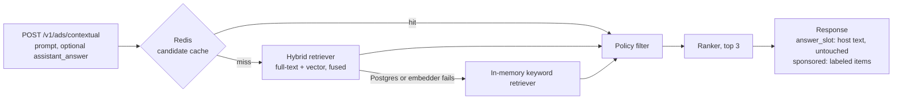
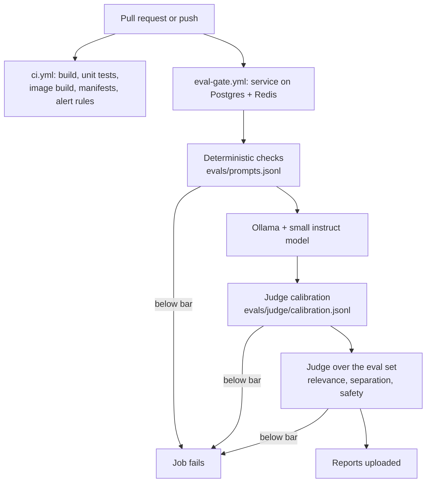

# Architecture

## Goal

Shopping assistants answer questions and can also show sponsored products. This service decides which
sponsored products fit a shopper's prompt and returns them in a labeled block that is separate from the
assistant's own answer. A gate runs on every change that could alter that behavior.

## Request flow

| Stage | Package | What it does |
| :-- | :-- | :-- |
| Candidate cache | `retrieval.CachingRetriever` | Redis, keyed by a normalized prompt, holds candidates before the policy filter. Off unless `CHATADS_CACHE_ENABLED=true`. |
| Hybrid retrieval | `retrieval.HybridRetriever` | Postgres full-text search and pgvector similarity, merged by reciprocal rank fusion. |
| Fallback | `retrieval.ResilientRetriever`, `retrieval.KeywordRetriever` | If hybrid retrieval throws, the in-memory keyword retriever answers and the request counts as `backend_error`. |
| Policy filter | `policy` | Drops products in banned categories (`policy/banned-categories.txt`). Runs after the cache, so a hit is filtered like a miss. |
| Rank | `ranking` | Score, then product id, top 3. |
| API | `api` | Validation, labeling, response DTOs. |

`answer_slot` is the host assistant's text. The host may send it as `assistant_answer`; the service returns it
untouched, never edits it and never uses it to pick ads. It is null when the host sends nothing.

## Hybrid retrieval

The catalog (`catalog.json`) is loaded into a `products` table at startup. Each row has a generated `tsvector`
column (title weighted highest, then keywords, then category, English stemming, GIN index) and a pgvector
`vector(N)` column (HNSW index, cosine distance). A row is re-embedded only when its text or the embedder
changed, and the table is rebuilt if the vector size changes.

For a prompt, the retriever runs two queries and fuses the ranked lists:

1. Full-text: the prompt's terms OR-ed into a `tsquery`, ordered by `ts_rank_cd`. This is Postgres's built-in
   ranking, not BM25. A hit counts only if the matched terms are worth at least two points (a title match is
   two, a keyword or category match is one), the same rule the keyword fallback uses. Without the gate, one
   common word like "travel" would pull in unrelated products.
2. Vector: nearest neighbours by cosine similarity. A hit counts only if its similarity is at least
   `chatads.retrieval.min-similarity` and at least half the best hit's similarity.
3. Fusion: reciprocal rank fusion with k = 60, so a product ranked well by both sides beats one that only one
   side found.

The gates exist because a nearest-neighbour query always returns something. Their values (`0.25` and `0.5`) were
tuned on the synthetic eval set for the offline embedder. A real embedding model has a different similarity
spread and needs its own `CHATADS_MIN_SIMILARITY`.

### Embedders

| Provider | Setting | Notes |
| :-- | :-- | :-- |
| Offline hashing | `CHATADS_EMBEDDING_PROVIDER=hash` (default) | Hashes stemmed words and character trigrams into 256 buckets. Deterministic, no network. Tolerates typos ("runing shose") but has no notion of synonyms. |
| OpenAI-compatible | `openai` | `POST {base}/embeddings`. Needs base URL, model, dimensions, usually a key. |
| Ollama | `ollama` | `POST {base}/api/embed`. No key. |

Real providers report input tokens, which feed the token and cost metrics. If a server omits usage, the count is
estimated at four characters per token and the series is tagged `source="estimate"`.

## Redis cache

The cache stores retrieval candidates (id, score, matched terms) before the policy filter, so editing the banned
list takes effect on cached entries immediately. Keys are `chatads:candidates:v1:` plus a SHA-256 of the embedder
id, the limit and the prompt lower-cased with punctuation collapsed. Results from the keyword fallback are never
cached, because the cache sits in front of the hybrid retriever only. Redis errors never fail a request: they count
as `cache_error` and the request continues uncached. Hits, misses and errors are `chatads_cache_total{result}`.

## Eval gate

- `ci.yml` builds, runs the unit and integration tests (Testcontainers Postgres and Redis), builds and smoke-tests
  the Docker image, validates the Kubernetes manifests with kubeconform, and runs promtool on the alert rules.
- `eval-gate.yml` starts Postgres and Redis as service containers, runs the packaged jar against them, checks that no
  request fell back to the keyword retriever, then runs the deterministic checks and the judge.
- Every pass bar is in `evals/thresholds.json`. The workflow only passes a mode flag.
- The judge reads `LLM_JUDGE_BASE_URL`, `LLM_JUDGE_MODEL` and optionally `LLM_JUDGE_API_KEY`. In the workflow it is
  Ollama running a small instruct model on the runner's CPU. Without configuration the step prints SKIPPED, except
  under `--require-judge`, which exits non-zero so the CI job cannot pass by skipping.

### Deterministic checks

Implemented in `dev.chatads.eval.DeterministicChecks` on the raw JSON tree: `schema_valid`, `labeled_sponsored`,
`ad_not_in_answer`, `no_banned_category`. `CaseEvaluator` adds `expected_category` from the eval set. The banned list
is one file read by both the policy filter and the check.

### Judge

One rubric per dimension in `evals/judge/` (relevance, ad-answer separation, safety), used verbatim as the system
prompt. The model must reply with exactly `{"score": 1-5, "reason": "..."}`; anything else gets one retry and is then
a format failure, never a guessed score. Format failures stay in the denominator. Calibration runs the judge over 36
labeled cases (34 count) and measures agreement with the labels. Costs are computed from `llm-prices.json`; a model
that is not listed counts as free.

A judge model this small is noisy. The bars in `evals/thresholds.json` are set from measured runs with margin, so they
catch a broken retriever or a broken rubric, not small drifts.

## Observability

Micrometer serves `/actuator/prometheus`.

| Metric | Labels | Meaning |
| :-- | :-- | :-- |
| `http_server_requests_seconds_*` | `uri`, `status` | Request latency histogram, the source of p50/p95/p99 |
| `chatads_requests_total` | | Contextual ad requests |
| `chatads_sponsored_served_total` | | Sponsored items returned |
| `chatads_policy_filtered_total` | | Candidates removed by the policy filter |
| `chatads_fallback_total` | `reason` | `no_match`, `policy_filtered`, `backend_error`, `cache_error` |
| `chatads_cache_total` | `result` | `hit`, `miss`, `error` |
| `chatads_llm_tokens_total` | `direction`, `operation`, `model`, `source` | Tokens from real model calls (`provider`) or the estimate |
| `chatads_llm_cost_usd_total` | `operation`, `model` | Estimated dollars from the price table |

`observability/grafana/dashboards/overview.json` charts these. `observability/alerts.yml` has six alert rules with
promtool unit tests in `alerts.test.yml`. A JUnit test checks that every metric named in the dashboard and the rules
is one the service exports. The token series appear only after a real model call, so with the offline embedder those
panels stay empty.

## Deployment

The `Dockerfile` is multi-stage and runs as a non-root user. `k8s/` has a namespace, ConfigMap, Deployment (two
replicas, startup, liveness and readiness probes, requests and limits, read-only root filesystem), Service, a secret
example and dev-only Postgres and Redis for local clusters. Liveness and readiness use Spring's probe groups, which
ignore Redis and Postgres on purpose because both have a fallback.

## Search backend decision

Postgres full-text plus pgvector in one container keeps the catalog in one place and runs from a single compose
service. OpenSearch can also do hybrid search but needs more memory and a second system for the catalog. Revisit if
catalog size or query volume outgrows one Postgres instance.
