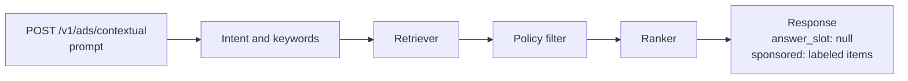
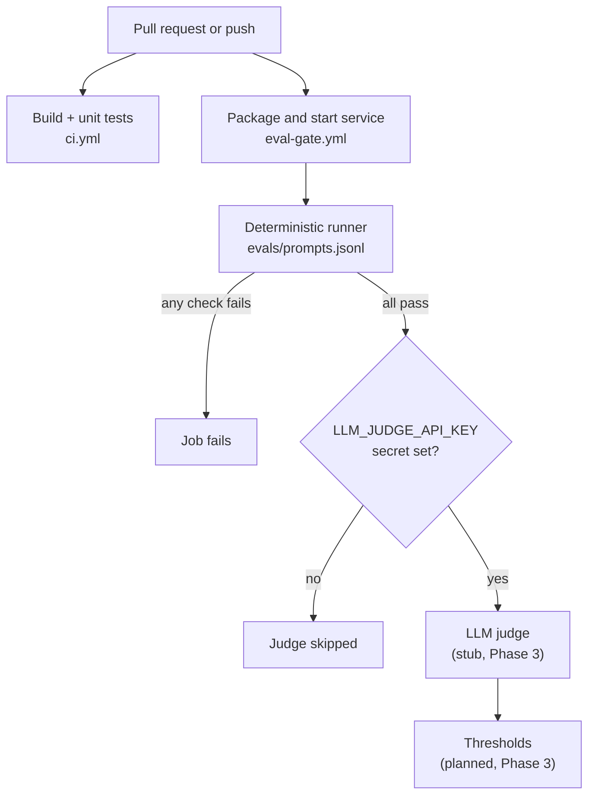

# Architecture

Status: Phase 1 is implemented. Everything marked planned is not built yet.

## Goal

Shopping assistants answer questions and can also show sponsored products. This service decides which
sponsored products fit a shopper's prompt and returns them in a clearly labeled block that is separate
from the assistant's own answer. A regression gate runs on every change that could alter that behavior.

## Request flow

| Stage | Package | Phase 1 (now) | Planned |
| :-- | :-- | :-- | :-- |
| Intent and keywords | `retrieval` | Stop-word removal and plural stemming | Intent classification |
| Retrieve | `retrieval` | Keyword overlap over an in-memory synthetic catalog | Hybrid keyword + vector search (Phase 2) |
| Policy filter | `policy` | Drops products in banned categories (`policy/banned-categories.txt`) | Prompt-level rules, per-market rules |
| Rank | `ranking` | Score, then product id, top 3 | Learned or business-rule ranking |
| API | `api` | Controller, request validation, response DTOs | Redis response cache (Phase 2) |
| Metrics | `metrics` | Request, served, fallback and policy-filtered counters | Token counters wired to a model (Phase 3/4) |

`answer_slot` is always `null` from this service. The host assistant owns the answer text; the slot exists so
the eval gate can check that ad text never leaks into it once a host fills it in.

## Search backend decision

Choice: Postgres full-text search plus the pgvector extension (`pgvector/pgvector:pg16`).

- One container serves both the keyword side (`tsvector`) and the vector side (`vector` column), so hybrid
  scoring happens in one SQL query and the catalog lives in one place.
- It runs from a single `docker compose` service with a small memory footprint, which keeps CI and laptops simple.
- OpenSearch can also do hybrid search, but it needs more memory, more setup and a second system for the catalog.

Revisit if catalog size or query volume outgrows a single Postgres instance. The compose service is provisioned;
the Phase 1 service does not connect to it.

## Eval gate

- `ci.yml` builds and runs the unit tests, including `EvalSetTest`, which pushes the whole eval set through the
  controller in-process.
- `eval-gate.yml` runs the packaged service and the same checks over real HTTP, then uploads `eval-report.json`.
- The judge step runs only when the secret exists. It is a stub today and scores nothing.

## Deterministic checks

Implemented in `dev.chatads.eval.DeterministicChecks` on the raw JSON tree, with no Spring dependency:
`schema_valid`, `labeled_sponsored`, `ad_not_in_answer`, `no_banned_category`. `CaseEvaluator` adds
`expected_category` using the eval set. The banned list is one file read by both the policy filter and the check,
so the filter and the check cannot drift apart.

## Observability

Micrometer exposes `/actuator/prometheus`. Latency comes from the built-in `http.server.requests` timer with a
percentile histogram. Custom counters: `chatads_requests_total`, `chatads_sponsored_served_total`,
`chatads_fallback_total`, `chatads_policy_filtered_total`, `chatads_llm_tokens_total` (registered, always zero
until a model is called). Grafana provisions a dashboard with three panels: p95 latency, token cost, fallback rate.

## Not built yet

Hybrid search, Redis caching, a real LLM judge, eval thresholds, token accounting, Kubernetes manifests.
See the roadmap in the README.
